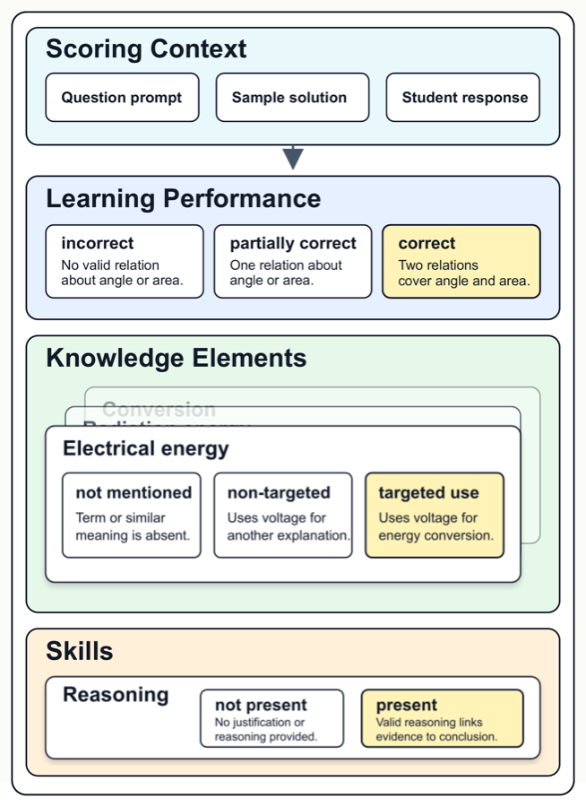

# ALICE

**A Large-Scale German Benchmark for Rubric-Based Multi-Dimensional Automatic Short Answer Scoring**

ALICE contains **16,572 student answers to 112 questions** from German K–12 classroom assessments in biology, chemistry, mathematics, and physics. Each question includes a prompt, a sample solution, and question-specific scoring rubrics for assessing student responses across three dimensions.

[Paper (EMNLP 2026)](https://arxiv.org/abs/2610.09661) · [Download dataset](alice_data_public.zip)

<p align="center">
  
</p>

## Scoring dimensions

| Dimension | Annotation | Levels |
|---|---|---|
| **Learning Performance (LP)** | One holistic score per answer | 0–2 |
| **Knowledge Elements (KE)** | One score per targeted knowledge element | 0–3 |
| **Skills (SK)** | One score per targeted skill | 0–2 |

Mathematics questions are annotated for LP only. Some question-specific rubrics omit intermediate levels.

## Data splits

| Split | Answers | Questions | Purpose |
|---|---|---|---|
| `train` | 10,781 | 90 | Training data |
| `test_ua` | 2,695 | 89 | Unseen answers to questions represented in training |
| `test_uq` | 3,096 | 22 | Unseen questions, disjoint from training |

## Data format

The dataset is distributed as [alice_data_public.zip](alice_data_public.zip):

```text
alice_data_public/
├── train.json
├── test_ua.json
├── test_uq.json
└── question_meta/
    ├── bio.json
    ├── chemie.json
    ├── math.json
    └── physik.json
```

Each split record contains an answer ID, a question ID, the student response, and scores for the applicable dimensions. Question metadata provides the prompt, sample solution, and rubric rules and descriptions for each scoring level. Records link to metadata through `question_id`.

## Rubric update (23 October 2026)

The dataset includes 25 supplementary rubric descriptions drafted with AI assistance using the question context, neighboring rubric levels, and sampled student answers. The corresponding entries in the original scoring guides contain dash placeholders; several are marked as collapsed or distinguish only the endpoint scores. Student answers, score labels, and data splits are unchanged.

## Licence

The anonymised student responses are released under [CC BY-NC-SA 4.0](LICENSE-DATA). Repository code is available under the [MIT licence](LICENSE).

## Citation

```bibtex
@inproceedings{sun-etal-2026-alice,
    title = "{Alice}: A Large-Scale German Benchmark for Rubric-Based Multi-Dimensional Automatic Short Answer Scoring",
    author = "Sun, Zhifan  and
      Gombert, Sebastian  and
      Lossjew, Jannik  and
      Wyrwich, Tobias  and
      Czinczel, Berrit Katharina  and
      Bednorz, David  and
      Kubsch, Marcus  and
      Neumann, Knut  and
      Drachsler, Hendrik",
    booktitle = "Proceedings of the 2026 Conference on Empirical Methods in Natural Language Processing",
    month = oct,
    year = "2026",
    address = "Budapest, Hungary",
    publisher = "Association for Computational Linguistics",
    url = "https://arxiv.org/abs/2610.09661"
}
```
